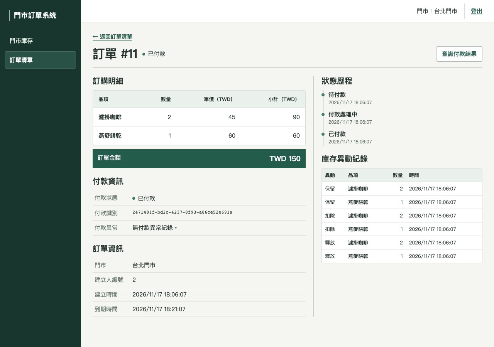

# 門市訂單系統

一套連鎖門市的訂單與庫存系統。門市人員可建立訂單並發起付款，總部可跨店查詢並操作模擬金流。



## 主要功能

- **門市權限**　店員操作本店資料，總部可切換台北及台中門市。
- **訂單與庫存**　可建立多品項訂單、依單號、狀態及日期搜尋，並查看實體與可售庫存。待付款訂單取消或到期時會釋放庫存。
- **模擬付款**　總部可決定付款結果並派送或重送通知。付款成功扣除庫存，付款失敗釋放庫存。訂單明細保留狀態歷程及庫存異動。

## 使用技術

| 層面 | 技術 |
| --- | --- |
| 前端 | Vue 3、TypeScript、Vite |
| 後端 | PHP 8.5、Laravel 13 |
| 資料庫與本機環境 | PostgreSQL 18、Docker Compose |
| 測試 | PHPUnit、Playwright Core |

## 啟動與測試

在專案根目錄執行。需要 Docker、Docker Compose 與 `openssl`。

### 本機啟動

```sh
./bin/local demo up
```

開啟 [展示站](http://127.0.0.1:8010)。登入帳密在 `.local/demo/accounts.json`。

### 停止與再啟動

```sh
./bin/local demo down
```

停止並移除展示容器與網路，保留資料卷及 `.local/demo/`。再次執行 `./bin/local demo up` 會沿用原資料與設定。只需重啟既有容器時，使用 `./bin/local demo restart`。

### 重設展示資料

```sh
./bin/local demo reset
```

核對工作目錄、Docker、資料庫與資料卷後，輸入 `reset store-ordering` 確認。重設會清除展示資料卷中的訂單、付款、庫存異動與待辦，並重新建立初始商品、庫存、示範帳號及通知簽章金鑰；沒有備份就無法復原。完成後網站會重新啟動，請從 `.local/demo/accounts.json` 取得新密碼登入。直接按 Enter 可取消。[重設範圍與失敗復原](docs/testing.md#重設示範資料)

### 手動驗證

1. **店員建立訂單。** 用 `taipei@example.test` 登入，在「門市庫存」按「建立訂單」。加入濾掛咖啡 2 件、燕麥餅乾 1 件並送出。明細應顯示「待付款」。記下訂單編號，再按「發起付款」。
2. **總部確認付款。** 登出後用 `hq@example.test` 登入，在「總部模擬付款」找到同一筆訂單，按「決定成功」，再按「立即送出／重送」。
3. **核對訂單與庫存。** 選擇台北門市，在「訂單清單」依編號開啟同一筆明細。若仍在處理中，稍候再開啟一次。確認明細顯示「已付款」、總額 TWD 150，兩個品項各有一筆保留、扣除及釋放，共六筆庫存異動。

### 自動化測試

瀏覽器測試需要 Node.js 22.12 以上、Chrome 或 Chromium，以及初始庫存的隔離測試站。

```sh
./bin/local test up
./bin/local test phpunit
(cd frontend && npm ci && npm run typecheck && npm run build && npm run test:browser)
./bin/local test down
```

[完整測試步驟與案例](docs/testing.md#測試手冊)
